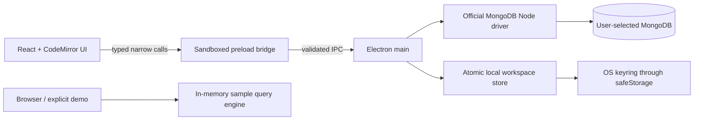

# Architecture

## Boundaries

`shared/contracts.ts` defines request/response types. `shared/validation.ts` validates every request in the main process. `electron/preload.ts` exposes only one typed command bridge, without raw IPC, Node, filesystem, process, or arbitrary network access. The main process verifies the requesting WebContents, main frame, and loaded application origin/file before dispatching.

`MongoService` owns all connection pools and MongoDB operations. Clients are explicitly connected, capped at five pooled connections, and closed on disconnect or quit. SRV/authentication/TLS/replica-set semantics are delegated to the official driver; query strings are parsed as Extended JSON, never evaluated as JavaScript. An optional SSH tunnel spawns the system `ssh` client (`-N -L` on a free 127.0.0.1 port, BatchMode, no shell) per connection and kills it when the client closes; the destination is validated so it can never be parsed as an ssh option.

The renderer runs with `sandbox: true`, `nodeIntegration: false`, `contextIsolation: true`, and web security enabled. The content policy excludes remote scripts, remote fonts, objects, and form submission. App navigation and new windows are blocked. Permission checks/requests are denied. Browser preview does not open a live database API.

## Data correctness

Canonical Extended JSON is retained beside display documents. It preserves ObjectId, numeric width, Int64 precision, Decimal128, binary, and dates through IPC and editing. Table formatting interprets EJSON wrappers for readability without converting Int64 to lossy JavaScript numbers.

Edits and deletes use an `_id` match plus `$expr` comparing the current whole document to the original with `$literal`. The operation fails closed when the original is stale. Replacements prohibit changing `_id`. Projected and aggregated results are marked read-only in the UI. Connection-level read-only is independently enforced in every mutating main-process command, regardless of renderer state.

Aggregation parses a bounded array of stages and rejects `$out`/`$merge`, including pipeline-bearing nested operators. Find, aggregate, and Explain are bounded by server processing time. Results are paged and capped at 16 MB of canonical JSON. Cursors are explicitly closed. Explain defaults to queryPlanner; executionStats is an explicit, cancellable command through the same connection-scoped AbortController registry. Find explains its displayed page without lookahead; aggregation explains the whole enabled pipeline without display pagination. Disabled stage indices are validated and persisted with queries. The entire draft is checked for forbidden write stages before disabled stages are filtered.

Successful executions append a local history entry, capped at 100. Query library entries are capped at 200. Export uses the retained canonical result page. CSV quote escaping and formula-prefix neutralization reduce surprises when opening exports in spreadsheets.

## Storage

The workspace store serializes concurrent updates, writes a fresh temporary file in the same directory, and atomically renames it into place. The file uses Unix `0600`; the created directory uses `0700`. Failed writes do not mutate the in-memory snapshot.

Connection metadata and encrypted URI blobs are stored together. Encryption/decryption uses Electron `safeStorage`; Linux's `basic_text` fallback is explicitly rejected. Session-only connections never persist a URI. URI-bearing driver errors are redacted before returning them to the UI. Saved connections remain disconnected until explicitly selected.

The renderer stores only theme and demo query/history preferences in localStorage. Real query/history state belongs to the main-process store. Sample data has no access to real connections.

## Source map

| Path                        | Responsibility                                                    |
| --------------------------- | ----------------------------------------------------------------- |
| `electron/main.ts`          | Window lifecycle, origin checks, IPC, keyring adapter             |
| `electron/preload.ts`       | Minimal typed bridge                                              |
| `electron/mongo-service.ts` | Driver operations, correctness/read-only rules, result limits     |
| `electron/store.ts`         | Atomic local persistence                                          |
| `shared/`                   | Contracts, validation, Extended JSON and CSV                      |
| `src/App.tsx`               | Workspace state and navigation                                    |
| `src/components/`           | Editor, accessible modal, connection/creation forms, BSON display |
| `src/demo.ts`               | Isolated sample workspace                                         |
| `scripts/`                  | Development, packaging preparation, read-only artifact reader     |
| `tests/`                    | Unit, real MongoDB integration, browser flows                     |

## References

- [Electron security guidance](https://www.electronjs.org/docs/latest/tutorial/security)
- [Electron sandboxing](https://www.electronjs.org/docs/latest/tutorial/sandbox)
- [Electron safeStorage](https://www.electronjs.org/docs/latest/api/safe-storage)
- [MongoDB Extended JSON](https://www.mongodb.com/docs/manual/reference/mongodb-extended-json/)
- [Official Node driver](https://www.mongodb.com/docs/drivers/node/current/)

These official references guided the implementation. They do not substitute for the verification results in `validation.md`.

## 0.2 rendering and lifecycle

Result rows are virtualized in `ResultsTable.tsx`; memoized props isolate them from query editing. `Editor.tsx` is a lazy boundary, with stable CodeMirror configuration in `JsonEditor.tsx`. Sample query dependencies load only when requested. Tree nodes mount children only while expanded.

Each pending query has a validated request ID and main-process AbortController. Stop and lifecycle cleanup abort the driver's cursor; stale responses cannot replace a newer page. Clipboard writes are a separate validated main-process operation; clipboard reads remain unavailable to the renderer. Boot returns active session metadata so renderer reload/demo switching can recover existing connections without exposing URIs.

## 0.3 aggregation and Explain

PipelineBuilder and ExplainPanel load on demand. Pipeline JSON remains the source representation; disabled-stage indices are separate optional query metadata. Invalid drafts remain editable across pane changes. Prefix previews retain the draft and store their executed scope separately; pagination is disabled for previews.

The Explain adapter understands classic winning plans, SBE queryPlan wrappers with planNodeId statistics, cursor-backed aggregation stages, and reported shard branches. It never sums stage timings or fabricates missing counts. Unfamiliar structures retain raw output behind a disclosure. Cardinality-changing operations do not produce a document-read amplification warning based on final grouped output. The demo-only example fixture loads separately and is visibly labeled.
